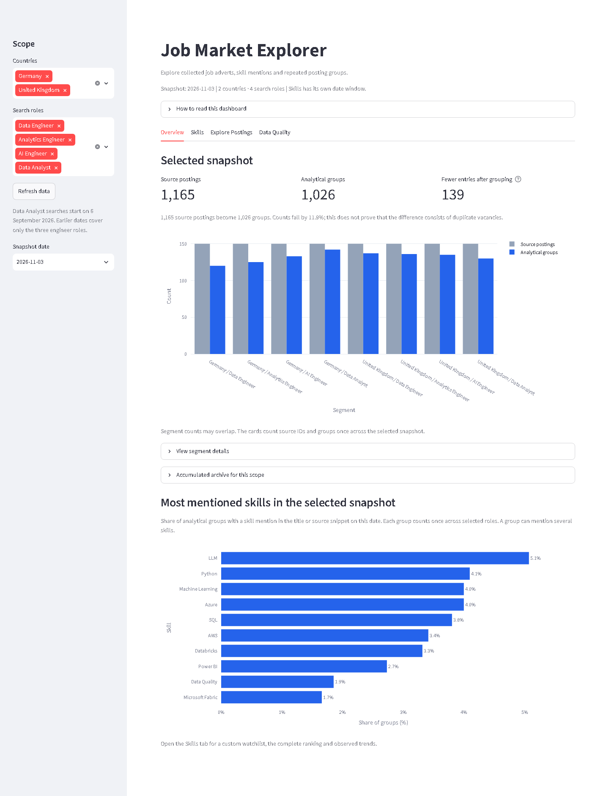
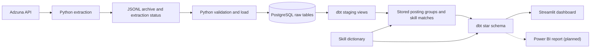

# Job Market Data Pipeline

[](https://github.com/oonursoylu/job-market-data-pipeline/actions/workflows/ci.yml)

I collect data-job adverts from Germany and the UK through the Adzuna API, keep every raw response, load them into PostgreSQL and model them with dbt. A Streamlit dashboard sits on top.

I built it to see which skills appear in these adverts and how repeated postings distort the counts. Most of the work went into things a dashboard does not show: loads that can be rerun safely, adverts that turn up more than once, data quality checks and a few slow queries.

**Built with:** Python · PostgreSQL · dbt Core · Streamlit · Plotly

## What's in it

- A batch pipeline that archives the raw API responses and records every date an advert appears in a search. One command runs extraction, loading and dbt, and a Windows scheduled task runs it every Monday, Wednesday and Friday.
- Archive validation and repeatable loading, so rerunning a load never inserts the same record twice. Each segment is written in a single transaction.
- Thirteen dbt models, three seeds and 169 data tests covering missing values, cleaning rules, uniqueness, relationships and count consistency, plus Python tests for extraction and loading. GitHub Actions runs the tests, the whole pipeline and dbt on invented data on every push.
- A star schema for reporting: one fact table of observations, dimension tables for dates, postings, posting groups, segments and skills, a bridge table that links posting groups to skills, and a coverage table that BI tools use for the date rule. Every column is documented, and dbt contracts stop the build if a column name or type changes, before the dashboard or a report sees it.
- A Streamlit dashboard for comparing skill mentions, browsing adverts and looking at repeated posting groups. Every number in it comes from SQL on the star schema.
- SQL performance work, with every faster version checked against the original output (details below).

The reporting covers four searches in both countries: Data Engineer, Analytics Engineer, AI Engineer and Data Analyst. I only started collecting Data Analyst adverts on 6 September 2026, so that role has fewer dates than the other three. Until 18 November 2026 I ran collection by hand, so the earlier dates are uneven.

## Dashboard

The Overview tab compares source postings with analytical groups for the selected date and shows the most mentioned skills. Country and role filters narrow the sample. All four roles are selected when it opens. Since Data Analyst collection started later, skill figures over several days only use dates from 6 September 2026 while that role is selected. The page shows the latest collection date and turns it into a warning when the data is more than four days old, which means a scheduled run was missed or failed.



| View | What it shows |
|---|---|
| Overview | Source postings compared with analytical groups, counts by country and role, and the top skills for the selected date |
| Skills | Rankings, a personal watchlist, trends and all 53 tracked skills, including those with no matched mentions |
| Explore Postings | Search by job title, company or location |
| Data Quality | Missing companies, truncated snippets, salary coverage, posting age, repeated posting groups and observed collection coverage |

The skill dictionary includes tools such as Databricks, Microsoft Fabric and Power BI because they come up in adverts. I did not use them to build this pipeline.

## Architecture



`python -m src.run_pipeline` runs the steps in order and stops at the first failure, so a bad extraction never reaches the database and a failed load never reaches dbt.

The dashboard reads only the star schema. Its queries in [dashboard/queries.py](dashboard/queries.py) apply the counting rules in SQL, and the same rules are described on the fact table in dbt, so another tool can follow them. A separate latest-postings mart keeps one row per advert with its latest search context. Each pipeline run checks source freshness and runs the dbt tests after loading.

## Scheduled run

```powershell
.\scripts\run_pipeline.ps1                # one run now; same as: python -m src.run_pipeline
.\scripts\register_scheduled_task.ps1     # once: Mon, Wed, Fri at 10:20, second try at 14:20
```

The run collects today's searches, validates and loads them, checks source freshness and runs `dbt build`. Everything it prints is appended to `logs/pipeline_YYYY-MM-DD.log`, and a failure gives a non-zero exit code, which Task Scheduler shows as the last result. The second run on the same day finishes anything the first one could not; when the day is already complete it only reruns dbt. If the laptop is off at both times, the task runs as soon as it is back on.

Running it twice on the same day is safe. Complete segments are skipped. A segment that failed has its status file renamed to `extraction_status.failed-<time>.json`, kept as a record, and is collected again. A segment left `in_progress` for more than an hour, for example because the laptop shut down during extraction, is handled the same way under a `stale-` name: the task is stopped after one hour and never runs twice at once, so that attempt cannot still be running. A more recent `in_progress` stops the run for a manual look. The load ignores rows it already has. Retries with growing waits handle API rate limits and server errors, and error messages never include the request URL, which carries the API key.

Before loading the run date, each run also loads any day from the last 14 days whose archives are on disk but not fully in PostgreSQL, for example when the database was down during both runs of a day. A day with a missing or inconsistent archive is reported in the log and skipped, so it never blocks the current run. For a day with a missing archive, loading its other segments by hand with `--countries` and `--roles` stops the warning.

I collect on Monday, Wednesday and Friday rather than every day. In the archives, collections one day apart shared 93% of their adverts and only 6% were new, so daily runs mostly saw the same adverts again. With a 2 to 3 day gap 68% were still there and 23% were new; with 4 to 7 days, 61% and 31%. The one-day figures come from only 19 segment pairs, all in June. Fixed weekdays also keep the dates evenly spaced, which matters more for trends than collecting often, and avoid weekend snapshots.

Countries and search roles, with the date each one started, are in `dbt_job_market/seeds/search_countries.csv` and `search_roles.csv`. Python and dbt both read them, so adding a role is one new row.

## Dashboard parity check

On 27 September 2026 I moved the dashboard's calculations from pandas to SQL on the star schema. [dashboard/check_parity.py](dashboard/check_parity.py) keeps a copy of the earlier pandas logic and compares it with the new queries for all 21 combinations of countries and roles, on every observed snapshot date. All 9,989 comparisons matched, including the order of skill rankings and posting lists, and shares and averages were exactly equal. When I broke five of the rules on purpose, the check caught every change.

Adding Data Analyst in November took the check up to 45 country and role combinations. On 3 November 2026 it ran 18,853 comparisons with no differences. After the November changes to text handling, it ran 19,025 comparisons with no differences on a copy of the database rebuilt from the archives.

[dashboard/check_bi_model.py](dashboard/check_bi_model.py) checks the columns added for Power BI: counting distinct `group_day_key` on the dates in `fct_segment_coverage` gives the dashboard's skill figures in all 90 scopes I compared (45 combinations, two date windows). Breaking the date rule or the distinct count on purpose made it fail.

## Backup and restore check

On 7 September 2026 I restored a PostgreSQL backup into a separate test database and compared it with the source. All 11 tables matched, including duplicate rows, and so did the table structures, constraints, indexes, views, ownership and sequence state. The comparisons were read-only and left the source database untouched. The restore ran on the same PostgreSQL 18.4 server, and the backup archive is kept outside Git.

The procedure and results are in [docs/backup_restore_verification.md](docs/backup_restore_verification.md).

## Performance

I looked for SQL that repeated work and checked that each faster version returned exactly the same rows. These measurements were taken locally on 6 September 2026.

| Change | Evidence |
|---|---|
| Latest-postings model uses `DISTINCT ON` instead of a `ROW_NUMBER()` filter | dbt model build: 62.35 s before, 0.71 s after. Read query: 59.42 s before, 0.25 s after. Both versions returned the same 5,002 rows, with no differences in either direction, and the 15 related tests passed. |
| Skill matches stored as a dbt table instead of a view | Reading the view took 24.35 s; reading the stored table took 0.006 s. All 2,051 rows matched, including duplicates. |
| Downstream models reuse the stored skill matches | Daily skill fact build: 24.73 s before, 0.21 s after. The star schema later replaced that model, and its skill bridge reads the same stored matches. |

For the latest-postings model, the query plan showed PostgreSQL estimating 1 row for a join that actually returned 5,002, so it chose nested loops that kept rescanning the same data.

The skill table itself was still slow to build. PostgreSQL inlines a CTE that is used only once, so the text cleaning (lower-casing and `regexp_replace`) ended up inside the join and ran again for every posting and skill pair. The model now declares that CTE as `MATERIALIZED`, so each posting's text is cleaned once. On 27 September 2026 the skill table build fell from 28.58 s to 2.78 s, and the new table matched the old one row for row in both directions.

Because the matches are stored, dbt has to run again after new postings are loaded or the dictionary changes.

On my machine the latest-postings model took 13.24 s in the 3 November build. On a copy rebuilt from the archives (PostgreSQL 16, 18 November 2026) I could reproduce it: the first build took 0.6 s, but every later build took about 5.5 s. A table rebuilt by dbt has no planner statistics until it is analysed, so PostgreSQL again expected 1 row from joins that returned 8,089. Two changes each fix it on their own, and I kept both:

| Change | Evidence (same copy, three builds each) |
|---|---|
| Every intermediate and mart table runs `analyze` right after it is built (`post-hook` in `dbt_project.yml`) | Unchanged model: about 5.5 s down to 0.60 to 0.66 s |
| The model reads the observations once with one `GROUP BY`, instead of a `DISTINCT ON` subquery joined to a second aggregate | 0.44 to 0.66 s without the hook; same 8,089 rows as before, column for column |
| Loader sends each segment as two batch inserts in one transaction, over one connection, instead of one statement per row and two connections per segment | Loading all 26 archived dates into an empty database: 7.6 to 8.1 s down to 2.4 to 2.6 s; both tables identical (row hashes match) |

The whole `dbt build` went from 8.3 to 8.7 s down to 4.9 to 5.3 s on that copy, while running 36 more tests. On my own machine, the first build after these changes (18 November 2026, 8,698 postings) took 13.3 s in total, down from 21.2 s on 3 November, and the latest-postings model took 1.71 s instead of 13.24 s.

<details>
<summary>Data handling and calculation details</summary>

### Collection and loading

Each default run asks for three pages of up to 50 results for eight country and role segments. That is up to 1,200 records, but the same advert can come back in more than one search, so a run has fewer distinct adverts than records.

Archives use this layout:

```text
data/raw/adzuna/country=XX/search_role=ROLE/date=YYYY-MM-DD/
  jobs.jsonl
  extraction_status.json
```

- An existing archive or status file blocks another extraction for that segment and date. The scheduled run resumes instead: it skips complete segments and retries failed or stale ones (see [Scheduled run](#scheduled-run)).
- JSONL is written to a temporary file first and never replaces an existing archive.
- Status files record the requested pages, records per page, completion status, description coverage and an archive checksum. From version 3 (18 November 2026) they also keep the total number of matching adverts Adzuna reports for each search. The archive keeps at most 150 of them, so the total is the only measure of volume; it is not loaded into PostgreSQL yet.
- The loader validates every archive expected for the date (eight since 6 September 2026) before it loads any segment.
- Older archives without a status file are accepted with a warning, because their page completion cannot be verified.
- Database constraints and `ON CONFLICT DO NOTHING` stop repeated postings and observations from being inserted again.
- Each segment's postings and observations are written in one transaction, so a segment is either fully loaded or not at all. If the database fails midway, earlier segments stay loaded, and a rerun completes the rest safely. A test forces the second insert to fail and checks that nothing is left behind.
- The loader writes exactly the records it validated; it does not read the archive a second time.
- The catalogue keeps the first version of each advert. When Adzuna later changes an advert's text, salary or title, only the new sighting is recorded. Of 4,134 adverts seen on more than one date, 210 had a different description later, about 178 a different salary, 51 a different title and 42 a different company name. Skill matching and grouping use the first version. The archives keep every version, so this can be revisited.

### Source postings and groups

The raw catalogue stores one row per `source + job_id`. Observations record each date a posting appeared in a country and role search.

Analytical groups combine source, country, normalised company, normalised title and a hash of the description. Location is left out on purpose, so the same advert posted in several cities falls into one group. Matching text can also mean reposts or separate vacancies with similar wording, so a group is not a verified unique vacancy, and the gap between source and group counts is not a confirmed duplicate count.

### Data cleaning and quality flags

Raw API values stay unchanged. Cleaning happens in dbt, so the source payload can always be audited.

- Missing company names show as `Unknown`, with `company_name_was_missing` set. These records get job-specific grouping keys, so they are never merged by accident.
- Non-positive salary bounds are treated as missing in the cleaned fields. The original values stay in `source_salary_min` and `source_salary_max`.
- Currency is only assigned when there is usable salary data. A missing source currency is inferred as EUR for Germany and GBP for the UK, and `salary_currency_was_inferred` keeps that lineage.
- Posting age and a 90-day stale flag are only quality signals, since an old advert can still be open. Training, internship and placement-style titles are flagged rather than deleted. The flag also covers German terms such as Werkstudent, Praktikum, Ausbildung, duales Studium and thesis adverts; adding them raised the German count from 33 to 98 adverts, and each of the 65 newly flagged titles is a working student, internship, apprenticeship, dual study or thesis advert.
- Description length, snippet status and likely truncation are exposed as columns for quality monitoring.

### Skill mentions

The dictionary covers 53 skills, including Databricks, Microsoft Fabric, Power BI, DAX, Power Query, dbt, Spark and A/B testing. Pipe-separated aliases handle variants such as `power bi|powerbi` and `spark|pyspark`, and a posting counts once per skill however many aliases match.

Matching works on whole words. Titles and snippets are lower-cased, anything other than letters and digits becomes a space, and an alias has to appear between spaces, so `scala` does not match "scalable". German letters (ä, ö, ü, ß) are kept: until November they were removed, which turned "Datenqualität" into "datenqualit t", and about three in four German snippets are in German. Keeping them and adding a few German aliases such as `datenqualität` and `datenmodellierung` added 80 matches and removed none. A test checks that every alias is written in this normalised form. Matching cannot read meaning, though: `excel` also matches the verb in "you will excel in this role", and `dax` matches the German stock index in "DAX-Konzern" (3 of the 23 German matches).

The public Adzuna Search API [only provides a description snippet](https://developer.adzuna.com/docs/search), so matching can miss requirements. A zero means no matched mention, not no demand. When the dictionary changes, rebuilding dbt rescores all stored text.

New status files record description coverage and the observed 500-character boundary. Full-text enrichment would need a licensed Adzuna dataset or another authorised source with complete descriptions. The pipeline does not scrape redirect pages.

The dashboard counts a group once per skill and date across the selected roles. A group can mention several skills, so percentages across skills do not add up to 100%.

For figures that span several days, the dashboard:

- includes only dates with observations in every selected country and role segment;
- counts a skill with no mention on an included date as zero, but does not add zeros for dates that were not collected;
- divides matching group-days by observed group-days for the percentage;
- includes zero-mention dates in the daily average.

Observed coverage does not prove that every requested API page completed, and the dashboard does not read the status files yet. The rules are applied in SQL in `dashboard/queries.py` and described on `fct_job_observations` in dbt, so a reporting tool can use the same definitions on the star schema.

</details>

## Run locally

The dashboard needs PostgreSQL and built dbt models. Its five-minute cache can be cleared with **Refresh data** after a successful build; the button does not run dbt.

The versions in `requirements.txt` are pinned to the ones tested with Python 3.12 on Windows. From the repository root in Windows PowerShell:

```powershell
python -m venv .venv
.\.venv\Scripts\Activate.ps1
pip install -r requirements-dev.txt
```

Copy `.env.example` to `.env` and add your local Adzuna and PostgreSQL credentials. Keep `.env` out of Git. Configure a local dbt profile named `dbt_job_market` that targets the PostgreSQL `analytics` schema. After creating the database and user, create the raw schema:

```powershell
psql -h localhost -U job_market_user -d job_market -f .\sql\001_create_raw_schema.sql
```

A database created before 18 November 2026 needs `sql\003_raw_schema_maintenance.sql` once. It removes a salary CHECK constraint that could reject a whole segment and a duplicate index; dbt now warns about such salaries instead.

The scheduled run does everything in one go (see [Scheduled run](#scheduled-run)). To run the steps one by one, from the repository root, stop if one fails:

```powershell
python -m src.extract.run_adzuna_extract
python -m src.load.run_postgres_load --check-only
python -m src.load.run_postgres_load
dbt source freshness --project-dir .\dbt_job_market
dbt build --project-dir .\dbt_job_market
python -m streamlit run dashboard\app.py
```

Python tests: `python -m pytest`. The four database tests run when `JOB_MARKET_TEST_DATABASE` names an empty test database. Lint: `ruff check src tests dashboard` (rules in `ruff.toml`).

[GitHub Actions](.github/workflows/ci.yml) repeats this on every push with a throwaway PostgreSQL 18: lint, all Python tests, then invented archives written through the real extractor, a full pipeline run with catch-up and `dbt build`, both parity checks and a headless dashboard test. The invented adverts in [tests/sample_data.py](tests/sample_data.py) cover repeated postings, missing companies, German text, training titles and salary placeholders; none of them come from Adzuna.

To compare the dashboard queries with the earlier pandas logic after a dbt build (this takes a few minutes):

```powershell
python dashboard\check_parity.py
```

To check that the columns added for Power BI give the dashboard's skill figures:

```powershell
python dashboard\check_bi_model.py
```

To validate or replay an archived date without fetching again:

```powershell
python -m src.load.run_postgres_load --date 2026-09-06 --check-only
python -m src.load.run_postgres_load --date 2026-09-06
```

The loader expects the segments that were being collected on that date, using the start dates in the seeds, so a date before 6 September 2026 loads without Data Analyst automatically. Both scripts take `--roles` and `--countries` to work on fewer segments, and the extractor takes `--resume` to skip complete segments and retry failed or stale ones.

Generate the dbt documentation with `dbt docs generate --project-dir .\dbt_job_market`. Raw-layer checks are in [sql/002_raw_data_quality_checks.sql](sql/002_raw_data_quality_checks.sql).

## Limitations

Adzuna is one source with a capped sample. Collection was manual until 18 November 2026, so earlier dates are uneven. Since then it runs on Monday, Wednesday and Friday, but only while my laptop is on; a missed run happens when the laptop is next on, so that sample can fall on another day. Training and placement adverts are flagged but not excluded. I do not compare salaries: coverage is incomplete, some amounts are predicted by Adzuna, and an inferred currency says nothing about pay period or what the figure includes. API descriptions are only snippets of the full advert.

## Next steps

1. A Power BI report on the star schema that uses the same counting rules as the dashboard. The model, relationships and DAX measures are planned in [docs/power_bi_model.md](docs/power_bi_model.md), and `dashboard/check_bi_model.py` already checks the rules in SQL.
2. Load Adzuna's total match counts into PostgreSQL, so reports can show volume as well as skills.
3. A second copy of the raw archives outside this laptop. The database can be rebuilt from them, but they cannot be collected again.
4. Later: a Docker setup.

Secrets, raw archives, backups, logs, virtual environments and generated dbt artifacts are excluded from Git.

## Licence

[MIT](LICENSE)

## Contact

Onur Soylu · [LinkedIn](https://www.linkedin.com/in/oonursoylu/)